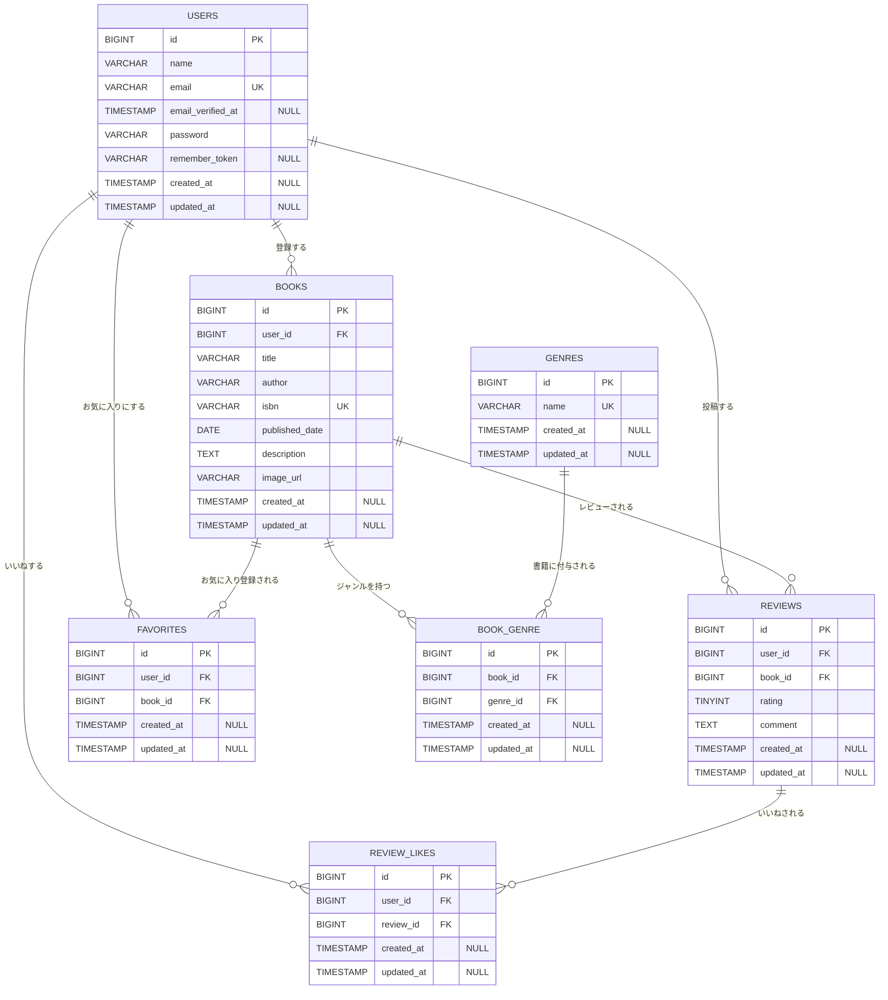

# ER図

書籍管理アプリケーションの主要テーブルとリレーションを示します。Laravel標準の補助テーブル（パスワードリセット、ジョブ、APIトークンなど）は含みません。

## 制約と補足

- `books.user_id` は書籍を登録したユーザーを参照します。ユーザー削除時は、そのユーザーの書籍も削除されます。
- `reviews` はユーザーと書籍の中間にあるレビューです。ユーザーまたは書籍の削除時にレビューも削除されます。
- `favorites` はユーザーと書籍の多対多関係を表し、`(user_id, book_id)` の組み合わせは一意です。
- `book_genre` は書籍とジャンルの多対多関係を表し、`(book_id, genre_id)` の組み合わせは一意です。
- `review_likes` はユーザーとレビューの多対多関係を表し、`(user_id, review_id)` の組み合わせは一意です。
- `users.email`、`books.isbn`、`genres.name` は一意です。
- `reviews.rating` は符号なしの1バイト整数です。`books.isbn` は13文字です。
- 外部キーの削除時動作は、各マイグレーションで指定されたカスケード削除です。
